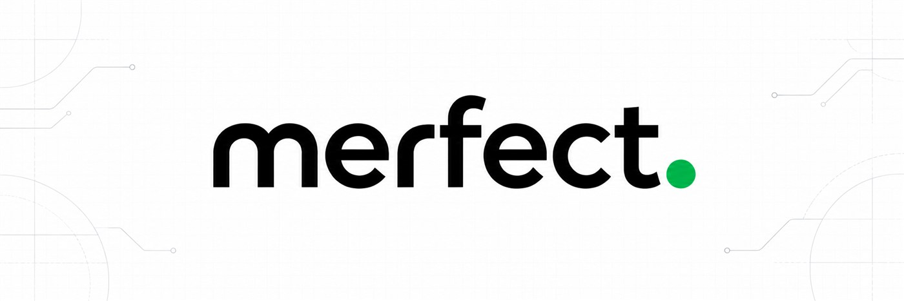
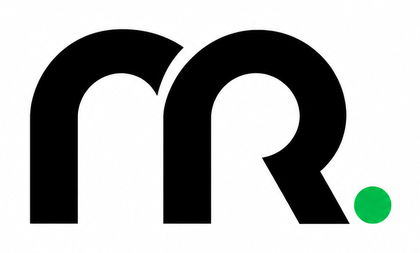

<div align="center">



# Hi, I'm Məmməd Rzayev

### Developer · Product Builder · Founder of Merfect

I build practical digital products around real-world problems — from mobile experiences and SaaS ideas to AI-powered tools and high-performance web applications.

[EMAIL](mailto:dveceses@gmail.com) &nbsp;·&nbsp; [GITHUB](https://github.com/Kvseis) &nbsp;·&nbsp; **MERFECT.**

</div>

---

## `01` About Me

<table>
<tr>
<td width="76%" valign="middle">

I am the founder of **Merfect**, a digital product agency focused on building ambitious web platforms, mobile applications, and SaaS products.

Merfect brings product strategy, UI/UX, and engineering together to turn strong ideas into polished digital products. I lead the product direction with a focus on clarity, performance, scalability, and real-world value.

</td>
<td width="24%" align="center" valign="middle">

<picture>
  <source media="(prefers-color-scheme: dark)" srcset="./assets/merfect-mark-dark.png">
  <source media="(prefers-color-scheme: light)" srcset="./assets/merfect-mark-light.png">
  
</picture>

</td>
</tr>
</table>

- Building across **mobile apps, SaaS, AI, and the web**
- Thinking in terms of **users, products, and practical outcomes**
- Leading product direction and digital work under **Merfect**
- Valuing **clarity, performance, and purposeful UI/UX**

## `02` What I Focus On

<table>
<tr>
<td width="50%" valign="top">

### ◈ Product Engineering

Turning ideas into focused digital experiences with clean structure and a clear purpose.

</td>
<td width="50%" valign="top">

### ◈ Mobile & SaaS

Exploring useful mobile experiences and scalable software products built around real needs.

</td>
</tr>
<tr>
<td width="50%" valign="top">

### ◈ AI-Powered Tools

Applying AI where it can improve a workflow, support a decision, or make a product more useful.

</td>
<td width="50%" valign="top">

### ◈ High-Performance Web

Creating fast, responsive, and polished web experiences with attention to usability.

</td>
</tr>
</table>

## `03` Technology Stack

<div align="center">

### Frontend & Web

<p><strong>React · Next.js · JavaScript · HTML5 · CSS3</strong><br />Responsive interfaces · Performance-focused web experiences</p>

### Backend & Data

<p><strong>Python · Firebase · SQLite</strong><br />Application logic · Data persistence · API integration</p>

### AI & Development Workflow

<p><strong>Gemini API · discord.py · Git</strong><br />GitHub Actions · pytest · Automated testing</p>

### Product & UI/UX
<p><strong>User flows · Interface structure · Usability · Visual clarity · Product thinking</strong></p>

</div>

I use this stack to take products from concept to a working release while keeping the experience responsive, understandable, testable, and maintainable.

## `04` How I Work

```text
Discover the problem
        ↓
Define the simplest useful solution
        ↓
Design with clarity
        ↓
Build for performance and reliability
        ↓
Learn, refine, ship
```

## `05` Entrepreneurship & Current Direction

Entrepreneurship is an important part of how I approach technology. I am interested not only in writing code, but also in identifying valuable problems, validating ideas, shaping products, and building solutions that can grow.

Through **Merfect**, I am focused on:

- Turning strong ideas into clear and useful digital products
- Building web platforms, mobile applications, and SaaS experiences
- Connecting product strategy, UI/UX, technology, and business thinking
- Learning from real users and improving products through feedback
- Growing as both a developer and an entrepreneur

---

<div align="center">

### Have an idea worth building?

For web platforms, mobile applications, SaaS products, or product collaboration:

**[dveceses@gmail.com](mailto:dveceses@gmail.com)**

**Think → Build → Improve**

<br />

<sub>Building products under <strong>Merfect.</strong></sub>

</div>
