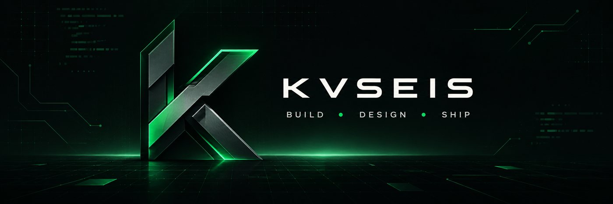

<div align="center">



<br />

# Hi, I'm Kvseis

### Developer · Product Builder · Entrepreneurial Thinker

I build practical digital products around real-world problems — from mobile experiences and SaaS ideas to AI-powered tools and high-performance web applications.

[](mailto:dveceses@gmail.com)
[](https://github.com/Kvseis)

</div>

---

## `01` About Me

I'm interested in the point where **technology, thoughtful design, and entrepreneurship** meet.

My goal is simple: understand a real problem, remove unnecessary complexity, and shape the solution into something clear, useful, and reliable. I care about both how a product works and how it feels to use.

- Building across **mobile apps, SaaS, AI, and the web**
- Thinking in terms of **users, products, and practical outcomes**
- Exploring ideas with an **entrepreneurial mindset**
- Valuing **clarity, performance, and purposeful UI/UX**

## `02` What I Focus On

<table>
<tr>
<td width="50%" valign="top">

### ◈ Product Engineering

Turning ideas into focused digital experiences with clean structure and a clear purpose.

</td>
<td width="50%" valign="top">

### ◈ Mobile & SaaS

Exploring useful mobile experiences and scalable software products built around real needs.

</td>
</tr>
<tr>
<td width="50%" valign="top">

### ◈ AI-Powered Tools

Applying AI where it can improve a workflow, support a decision, or make a product more useful.

</td>
<td width="50%" valign="top">

### ◈ High-Performance Web

Creating fast, responsive, and polished web experiences with attention to usability.

</td>
</tr>
</table>

## `03` Technology Stack

<div align="center">

[](https://github.com/Kvseis)

<br />


</div>

## `04` How I Work

```text
Discover the problem
        ↓
Define the simplest useful solution
        ↓
Design with clarity
        ↓
Build for performance and reliability
        ↓
Learn, refine, ship
```

## `05` Consistency

<div align="center">

[](https://github.com/Kvseis)

</div>

---

<div align="center">

### Have an idea worth building?

For collaboration, freelance inquiries, or a conversation about a product:

**[dveceses@gmail.com](mailto:dveceses@gmail.com)**

<br />


</div>
